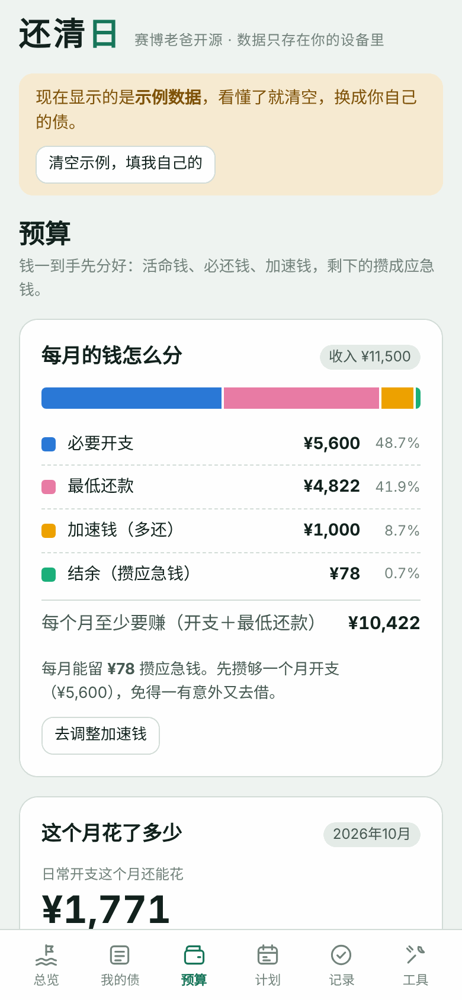
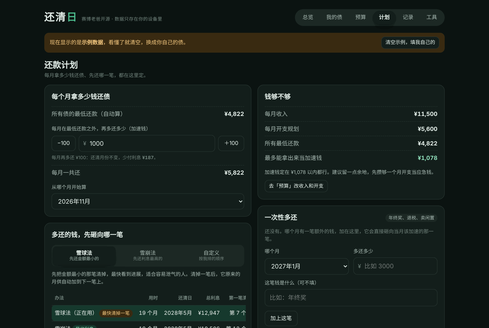

# 还清日

一个免费开源的还债计划工具。把每一笔债填进去，它会告诉你：**每个月该怎么还、先还哪一笔、哪天能还清。**

👉 **在线使用：https://cyberdaddyleo.github.io/huanqingri/**

手机、电脑都能用，不用注册，不用下载。数据只存在你自己的设备里。

赛博老爸开源 · 配套[《负债上岸 SOP》](docs/负债上岸SOP.md)和[《还债表.xlsx》](docs/还债表.xlsx)

  
  

  

---

## 它能做什么

- **算出你的还清日**：按你每月能拿出的钱，算出哪年哪月还完、总共还要付多少利息。
- **三种还法**：
  - 雪球法：先还金额最小的，最快看到进展
  - 雪崩法：先还利息最高的，总利息最少
  - 自定义：自己排顺序

  三种办法并排对比，自己挑。
- **每月还款表**：每个月每笔该还多少，"加速钱"该砸向哪一笔，一目了然。清掉一笔后，它原来的月供自动加到下一笔上。
- **一次性多还**：年终奖、退税这类额外的钱，加进计划里，看能提前多少。
- **收入明细**：工资、副业、其他收入一项项填，自动合计。
- **开支规划**：每类开支定一个月预算，分「固定」（房租、话费）和「日常」（吃饭、交通、零花）。一张条形图看清每月收入怎么分：必要开支、最低还款、加速钱、结余。
- **日常记账**：每花一笔就记下，自动算出这个月日常开支还能花多少、剩下的天数平均每天能花多少，哪一类超了会标出来。
- **钱够不够**：算出每月至少要赚多少；收入付不起最低还款、加速钱定多了，都会提醒。
- **记录还款**：每还一笔就记下来，欠款自动减少；清掉一笔会提醒你。
- **利率换算**：日息、月息、分期手续费、"到手多少、每期还多少"，统一换算成真实年化。
- **风险提醒**：最低还款比利息还少、年化超过 24%、民间借贷超过法定上限，都会提示。

## 隐私

**所有数据只存在你自己设备的浏览器里，不上传任何服务器。** 没有账号、没有统计、没有广告。

所以换手机、清理浏览器之前，请到「工具 → 备份和换设备」里复制或下载备份。

## 怎么用

- **在线用**：打开上面的在线地址。在手机浏览器里打开后，可以「添加到主屏幕」，用起来像个 App。
- **离线用**：下载 [`index.html`](index.html)，用浏览器直接打开。
- **自己部署**：整个工具就是一个文件 `index.html`，不需要服务器，也不需要安装任何东西。放进 GitHub Pages、Cloudflare Pages 或者任何静态网站目录都能用。

## 配套资料

| 文件 | 是什么 |
|---|---|
| [docs/负债上岸SOP.md](docs/负债上岸SOP.md) | 六步上岸：盘点、止血、协商、排序、增收、防复发。附一段可以直接复制到豆包、DeepSeek 里用的「AI 上岸教练」提示词 |
| [docs/还债表.xlsx](docs/还债表.xlsx) | Excel 版还债表，Excel、WPS、飞书都能打开。跟网页版用同一套算法 |

## 计算方法

- 每月利息 = 欠款 × 年化 ÷ 12（四舍五入到分）。这是简化算法，和银行实际账单会有小误差，以账单为准。
- 每个月先给每笔债还最低还款，剩下的钱（加速钱 + 当月的一次性多还）按顺序砸向排在最前面的债。
- 最多计算 30 年。

## 改造

代码是原生 HTML + CSS + JavaScript，没有任何依赖，也没有构建步骤。颜色都在文件开头的 `:root` 里，改几个值就能换成你自己的配色。

## 许可

[MIT](LICENSE)。随便用、随便改、随便分享。**请不要拿去包装成付费课程卖给欠债的人。**

## 免责

本工具只做计算，不构成法律意见或投资建议。具体以你的合同条款、银行和平台的官方答复为准。

撑不住的时候，请找家人朋友聊聊，或者拨打心理援助热线 **12356**。
